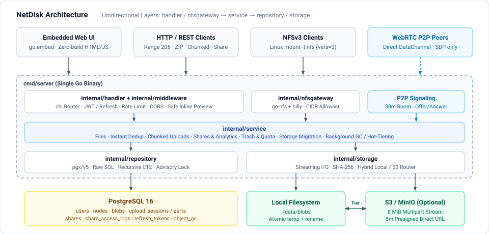

# NetDisk

[简体中文](README.md) | English

[](https://github.com/MiraiNoShiori/netdisk/actions/workflows/ci.yml)
[](https://github.com/MiraiNoShiori/netdisk/releases)
[](go.mod)
[](LICENSE)

A self-hosted personal cloud drive written in Go and PostgreSQL. It focuses on streaming file I/O with constant memory usage, SHA-256 content deduplication, resumable chunked uploads, directory trees, recoverable trash, storage quotas, and share links, plus optional Local/S3 hybrid tiering, an NFSv3 gateway, and LAN WebRTC P2P direct transfers.

The web UI is plain HTML/CSS/JS embedded into the server binary via `go:embed`—no Node.js toolchain or frontend build step required.



## Features

- **Streaming File I/O & Safe Preview**: Multipart uploads stream straight to storage while hashing SHA-256; downloads use `http.ServeContent` for `Range / 206` resume; folders stream as ZIP archives via `io.Pipe` using a single recursive CTE (no N+1 queries). Inline preview (`?inline=1`) allowlists images, media, PDF, and plain text while rejecting HTML/SVG with `X-Content-Type-Options: nosniff`.
- **Auth & Sessions**: Registration, login, token revocation on logout, profile/email updates, password change, and account deletion. Uses short-lived JWT access tokens with single-use rotating refresh tokens (auto-renewed on 401 in the UI) and per-IP rate limiting on auth and share-code verification endpoints.
- **Directory Tree & Search**: Create, rename, and move nodes with PostgreSQL recursive CTE cycle detection (`CYCLE` clause); full-drive search, type filter, sorting, pagination, and ancestor breadcrumbs.
- **Deduplication & Chunked Uploads**: Content-addressed SHA-256 deduplication with instant-upload probing; 4 MiB chunked uploads with idempotent `(session_id, part_no)` retries and PostgreSQL advisory-lock serialization on completion.
- **Trash & Quotas**: Soft delete into a recoverable trash with one-click subtree restore. Physical blobs are only reclaimed via `NOT EXISTS` checks after permanent deletion, emptying trash, or `NETDISK_TRASH_RETENTION` expiry (default 30 days)—no error-prone `ref_count` column. Default 10 GiB per-user quota with deduplication savings stats.
- **Shares & Analytics**: File and folder sharing with expiry, bcrypt passcodes, and atomic max-download limits, plus access logs (unique IPs, failed attempts, 7-day trend).
- **Local / S3 Hybrid Storage & Hot Tiering**: Run local disk and S3/MinIO side by side with per-file bidirectional migration (copy + SHA-256 verify → CAS DB pointer swap → source delete) and 5-minute presigned URLs. Optional background hot-tiering migrates frequently downloaded local files to S3 once `NETDISK_AUTO_TIER_THRESHOLD` is met.
- **NFSv3 Gateway**: Export a single user's drive over TCP NFSv3 (`go-nfs` + `billy`) routed through the same service layer (dedup, quotas, and storage routing stay intact).
- **LAN WebRTC P2P Transfer**: `/p2p.html` creates a 30-minute signaling room for browser-to-browser DataChannel file transfer with end-to-end SHA-256 verification. File bytes never touch the server.

## Tech Stack & Architecture

Strict one-way layering: `handler / nfsgateway → service → repository / storage`.

- **Go 1.27+** + `net/http` + [`chi`](https://github.com/go-chi/chi): Thin routing and middleware; business logic stays independent of HTTP.
- **PostgreSQL 16** + [`pgx/v5`](https://github.com/jackc/pgx): Raw SQL (no ORM) for explicit transaction boundaries, recursive CTEs, `COALESCE` root-directory uniqueness indexes, and advisory locks.
- **MinIO Go SDK**: Fixed 8 MiB streaming multipart uploads and presigned downloads.
- **`go-nfs` + `billy`**: Lightweight TCP NFSv3 server adapter.
- **Embedded Web UI (`go:embed`)**: Zero-dependency vanilla JS bundled into a single binary.

## Quick Start

### Option 1: Docker Compose

```sh
docker compose up -d
```

Open **http://localhost:8081** and register your first account.

> Before exposing NetDisk beyond localhost/LAN, replace `NETDISK_JWT_SECRET` (e.g. `openssl rand -hex 32`) and disable public registration once initial accounts are created. See [SECURITY.md](SECURITY.md).

### Option 2: Run from Source

Requires Go 1.27+ and Docker Compose (Linux / macOS / Windows):

```sh
docker compose up -d postgres
cp .env.example .env
go run ./cmd/server
```

Database migrations (`migrations/0001` through `0006`) run automatically on startup. To run migrations separately: `go run ./cmd/migrate`.

## Optional Capabilities

### Hybrid S3 / MinIO & Hot Tiering

Start the bundled MinIO profile for local testing:

```sh
docker compose --profile objectstore up -d --build
```

Uncomment `NETDISK_S3_*` in `.env` and restart. You can migrate individual files between `LOCAL` and `S3`, generate 5-minute presigned download URLs, or set `NETDISK_AUTO_TIER_THRESHOLD` (e.g. `10`) and `NETDISK_AUTO_TIER_MIN_SIZE` (default `1048576`) to offload hot local files to S3 automatically.

### Mounting via NFSv3

Register the target account in the web UI first, then enable the gateway in `.env`:

```dotenv
NETDISK_NFS_ADDR=127.0.0.1:2049
NETDISK_NFS_USER=demo
NETDISK_NFS_CLIENTS=127.0.0.1/32,::1/128
```

Mount on Linux (with `nfs-common` installed):

```sh
sudo mkdir -p /mnt/netdisk
sudo mount -t nfs -o vers=3,proto=tcp,port=2049,mountport=2049,nolock,actimeo=0 \
  127.0.0.1:/ /mnt/netdisk
```

By default the gateway listens on loopback only. Add trusted LAN subnets to `NETDISK_NFS_CLIENTS` when needed; never expose NFSv3 to the public internet.

### LAN WebRTC P2P

Open `/p2p.html` after signing in, pick a local file, and share the one-time link (valid for 30 minutes). The receiver does not need an account; transfer runs directly over WebRTC DataChannel with live speed/ETA and post-transfer SHA-256 verification.

## Security Boundaries & Known Limitations

All deployment options use the `NETDISK_*` prefix (legacy unprefixed names remain supported for backward compatibility):

- **Registration & Instant Upload**: Set `NETDISK_ALLOW_REGISTER=false` after creating accounts. By default, instant upload only reuses blobs still referenced by the caller's own live nodes. Setting `NETDISK_ALLOW_GLOBAL_INSTANT_UPLOAD=true` permits cross-account deduplication by SHA-256 + size.
- **Reverse Proxy & Download Cookies**: Download cookies are scoped to file downloads, inline previews, and folder ZIPs; all other private APIs require a Bearer token. When terminating TLS at a reverse proxy, set `NETDISK_COOKIE_SECURE=true` (or use `auto` with `NETDISK_TRUSTED_PROXY_CIDRS` and ensure the proxy overwrites client `X-Forwarded-Proto`).
- **Concurrent Blob GC**: `Upload`, `InstantUpload`, and chunked `Complete` register/lock the blob (`ON CONFLICT` / `FOR SHARE`) and insert the node inside a single database transaction. The NFS write-back path (`internal/service/filesystem.go`) still performs a two-step upsert and node update, leaving a narrow theoretical race window under extreme concurrency.
- **NFSv3 Scope**: Built on `willscott/go-nfs v0.0.4`. Access control relies on source CIDR allowlisting (one user per gateway instance); not intended for database workloads, hard links, or POSIX file locks.
- **P2P Connectivity**: No STUN/TURN servers are configured; intended for direct LAN reachability. Symmetric NAT, strict firewalls, or Wi-Fi client isolation may block peer connections.
- **PDF Inline Preview**: Inline responses send `X-Content-Type-Options: nosniff`, though PDFs are still parsed by the browser. For public multi-tenant deployments, add strict reverse-proxy CSP headers or isolate previews on a separate origin.

## Testing & Benchmarks

### Unit Tests & Static Checks

```sh
gofmt -l .
go vet ./...
go test -count=1 ./...
```

### Local Storage Benchmarks

```sh
go test -run=^$ -bench=. -benchmem ./internal/storage
```

Streaming I/O keeps heap allocations constant (~35 KiB/op, 23 allocs/op for a 4 MiB streaming write; ~136 KiB/op, 56 allocs/op for 4×1 MiB chunk concatenation). Earlier server profiling recorded ~209 KiB RSS delta during a 500 MiB upload and ~180 KiB RSS delta during a 150 MiB streaming ZIP download (see [devlog.md](devlog.md)).

### Full Integration Suite (PostgreSQL + MinIO + NFS + `-race`)

```sh
docker compose -p netdisk-test -f compose.test.yml up -d --build --wait
sh scripts/verify.sh
docker compose -p netdisk-test -f compose.test.yml down
```

## Documentation

- API Reference: [docs/api.md](docs/api.md) · OpenAPI 3.1: [docs/openapi.json](docs/openapi.json)
- Database Schema: [docs/schema.md](docs/schema.md)
- Engineering & Design Notes (Chinese): [devlog.md](devlog.md)
- Contributing: [CONTRIBUTING.md](CONTRIBUTING.md) · Security Policy: [SECURITY.md](SECURITY.md)

## License

[MIT](LICENSE)
