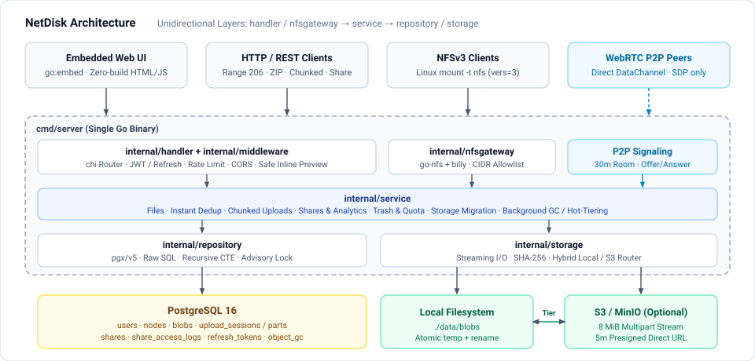

# NetDisk

简体中文 | [English](README.en.md)

[](https://github.com/MiraiNoShiori/netdisk/actions/workflows/ci.yml)
[](https://github.com/MiraiNoShiori/netdisk/releases)
[](go.mod)
[](LICENSE)

基于 Go 和 PostgreSQL 的自托管个人网盘服务。核心覆盖文件流式读写、内容去重与秒传、分片断点续传、目录树管理、可恢复回收站、配额统计、分享访问控制，同时提供 Local / S3 混合分层存储、NFSv3 目录挂载和局域网 WebRTC P2P 直传。

内嵌零构建原生 HTML / CSS / JS Web 控制台（经 `go:embed` 打包进单个二进制），无 Node.js 构建链依赖。



## 核心功能

- **流式文件 I/O 与预览**：multipart 流式上传，文件正文不入内存；下载支持 `Range / 206` 断点续传；目录支持经 `io.Pipe` 流式打包 ZIP（单条递归 CTE 消除 N+1 查询）；图片、音视频、PDF 和纯文本支持 `?inline=1` 安全预览，HTML/SVG 默认拦截并强制 `nosniff`。
- **账号与会话安全**：支持注册、登录、登出吊销、资料修改、邮箱绑定、改密和注销。采用 Access Token + 单次消费 Refresh Token 轮换机制（前端遇 401 自动续期重放），登录与提取码校验接口均带按 IP 限流。
- **目录树与检索**：支持目录新建、改名、移动（PostgreSQL 递归 CTE + `CYCLE` 子句环检测）、全盘模糊搜索、按类型筛选、排序分页与祖先面包屑定位。
- **内容去重与分片续传**：按 SHA-256 去重；支持客户端先算哈希秒传；大文件默认按 4 MiB 分片上传，分片按 `(session_id, part_no)` 幂等覆盖，由 PostgreSQL advisory lock 串行化合并收尾。
- **回收站与容量配额**：默认软删进入回收站，支持整棵子树一键恢复；仅在彻底删除、清空回收站或超过 `NETDISK_TRASH_RETENTION`（默认 30 天）后台清理后，通过 `NOT EXISTS` 校验确认全局无引用再回收物理对象。每用户默认 10 GiB 配额，提供去重节省空间统计。
- **分享链接与访问分析**：支持文件和目录分享，可设有效期、bcrypt 提取码和原子扣减的最大下载次数；记录独立访客、错密次数和近 7 天访问趋势。
- **Local / S3 混合存储与热点分层**：支持本地盘与 S3/MinIO 并存、单文件双向迁移（复制校验 SHA-256 → CAS 切指针 → 删源对象）及 5 分钟签名直链；配置 `NETDISK_AUTO_TIER_THRESHOLD` 后，高频本地文件自动迁移至 S3。
- **NFSv3 网关**：可将指定用户的网盘目录以 NFSv3 协议导出到受信局域网，读写统一经业务层走去重、配额与存储路由。
- **局域网 WebRTC P2P 直传**：`/p2p.html` 提供 30 分钟临时信令房间，服务端仅交换 SDP 元数据，文件通过浏览器 DataChannel 点对点传输并在接收端校验 SHA-256。

## 技术栈与分层

代码遵循单向依赖：`handler / nfsgateway → service → repository / storage`。

- **Go 1.27+** + `net/http` + [`chi`](https://github.com/go-chi/chi)：薄封装路由与中间件，业务层不耦合 HTTP。
- **PostgreSQL 16** + [`pgx/v5`](https://github.com/jackc/pgx)：手写 SQL（无 ORM），便于控制事务边界、递归 CTE、`COALESCE` 根目录唯一索引与 advisory lock。
- **MinIO Go SDK**：固定 8 MiB 流式分片上传与签名直链。
- **`go-nfs` + `billy`**：TCP NFSv3 协议适配。
- **原生前端（`go:embed`）**：零框架依赖，单二进制直接部署。

## 快速开始

### 方式一：Docker Compose 一键启动

```sh
docker compose up -d
```

服务启动后访问 **http://localhost:8081**，注册首个账号即可进入控制台。

> 生产部署前请务必替换 `NETDISK_JWT_SECRET`（如 `openssl rand -hex 32`），并在建完账号后关闭公开注册。详见 [SECURITY.md](SECURITY.md)。

### 方式二：本地源码运行

需要 Go 1.27+ 和 Docker Compose（Windows / GNU/Linux 均可）：

```sh
docker compose up -d postgres
cp .env.example .env
go run ./cmd/server
```

服务启动时会自动按序执行 `migrations/0001` 到 `0006` 增量迁移；如需单独执行迁移，可运行 `go run ./cmd/migrate`。

## 进阶配置

### S3 / MinIO 混合存储与热点分层

本地可使用内置的 MinIO profile 拉起对象存储：

```sh
docker compose --profile objectstore up -d --build
```

在 `.env` 中取消 `NETDISK_S3_*` 注释并重启服务后：
- 可在控制台查看文件当前所在后端（`LOCAL` / `S3`），按需双向迁移，或为 S3 对象生成 5 分钟直链；
- 配置 `NETDISK_AUTO_TIER_THRESHOLD`（如 `10`）与 `NETDISK_AUTO_TIER_MIN_SIZE`（默认 `1048576`）后，后台任务会自动将达到阈值的本地热点文件迁往 S3，也可在「存储与分层」面板手动触发扫描。

### NFSv3 目录挂载

先在 Web 端注册要导出的账号，在 `.env` 中配置并重启服务：

```dotenv
NETDISK_NFS_ADDR=127.0.0.1:2049
NETDISK_NFS_USER=demo
NETDISK_NFS_CLIENTS=127.0.0.1/32,::1/128
```

在 Linux 客户端安装 `nfs-common` 后挂载：

```sh
sudo mkdir -p /mnt/netdisk
sudo mount -t nfs -o vers=3,proto=tcp,port=2049,mountport=2049,nolock,actimeo=0 \
  127.0.0.1:/ /mnt/netdisk
```

NFS 网关默认仅绑定回环地址，局域网其他主机访问需显式加入 `NETDISK_NFS_CLIENTS` 白名单；单个实例对应单个用户目录，切勿暴露至公网。

### 局域网 P2P 点对点直传

登录后进入 `/p2p.html`，选择本地文件即可生成 30 分钟有效的一次性链接。接收端无需登录，打开链接选择保存位置后通过 WebRTC DataChannel 直连传输，页面展示实时速率与 ETA，并在传输结束后核对 SHA-256。

## 安全边界与已知限制

所有部署配置项统一使用 `NETDISK_*` 前缀（同时向后兼容不带前缀的旧环境变量名）：

- **注册与秒传策略**：创建初始账号后可设 `NETDISK_ALLOW_REGISTER=false` 关闭公开注册。秒传默认仅复用当前用户仍有存活引用的内容；仅在显式设置 `NETDISK_ALLOW_GLOBAL_INSTANT_UPLOAD=true` 时允许跨账号按 SHA-256 与大小命中复用。
- **反向代理与下载 Cookie**：文件下载、同路径内联预览和目录 ZIP 支持下载 Cookie，其余私有 API 强制 Bearer Token。在反代终止 TLS 时建议设 `NETDISK_COOKIE_SECURE=true`；使用 `auto` 时仅直连 TLS 或来自 `NETDISK_TRUSTED_PROXY_CIDRS` 且带 HTTPS 头的请求启用 `Secure`，反代侧需覆盖客户端传入的 `X-Forwarded-Proto`。
- **并发内容回收**：`Upload`、`InstantUpload` 与分片 `Complete` 已将 blob 登记/锁定（`ON CONFLICT` / `FOR SHARE`）与节点插入收敛在同一数据库事务内，消除对应路径的并发 GC 窗口；NFS 写回路径（`internal/service/filesystem.go`）仍为两步更新，极端并发场景下存在极窄回收窗口。
- **NFSv3 定位**：基于 `willscott/go-nfs v0.0.4`，属于轻量局域网特性，仅靠来源 CIDR 做访问控制，不适用于数据库存储、硬链接或 POSIX 文件锁场景。
- **P2P 网络限制**：当前未配置 STUN/TURN 中继，适用于两端可直连的局域网；跨对称 NAT、防火墙或开启客户端隔离的 Wi-Fi 可能无法建连。
- **PDF 内联预览**：内联响应已带 `X-Content-Type-Options: nosniff`，但 PDF 仍由浏览器内核解析；公网多用户部署建议在反代层附加更严格的 CSP 或独立预览域隔离。

## 测试与性能验证

### 单元测试与静态检查

```sh
gofmt -l .
go vet ./...
go test -count=1 ./...
```

### 流式存储基准测试

```sh
go test -run=^$ -bench=. -benchmem ./internal/storage
```

流式读写路径保持常数级堆分配（单次 4 MiB 本地流式写入约 35 KiB/op、23 allocs/op；4×1 MiB 分片拼接约 136 KiB/op、56 allocs/op）。此前实测 500 MiB 上传与 150 MiB 流式 ZIP 打包的服务端 RSS 增量均在 ~200 KiB 量级（详见 [devlog.md](devlog.md)）。

### 全量集成测试（PostgreSQL + MinIO + NFS + `-race`）

```sh
docker compose -p netdisk-test -f compose.test.yml up -d --build --wait
sh scripts/verify.sh
docker compose -p netdisk-test -f compose.test.yml down
```

## 相关文档

- 接口文档：[docs/api.md](docs/api.md) · OpenAPI 3.1：[docs/openapi.json](docs/openapi.json)
- 数据库表结构：[docs/schema.md](docs/schema.md)
- 设计取舍与踩坑记录：[devlog.md](devlog.md)
- 贡献指南：[CONTRIBUTING.md](CONTRIBUTING.md) · 安全策略：[SECURITY.md](SECURITY.md)

## License

[MIT](LICENSE)
